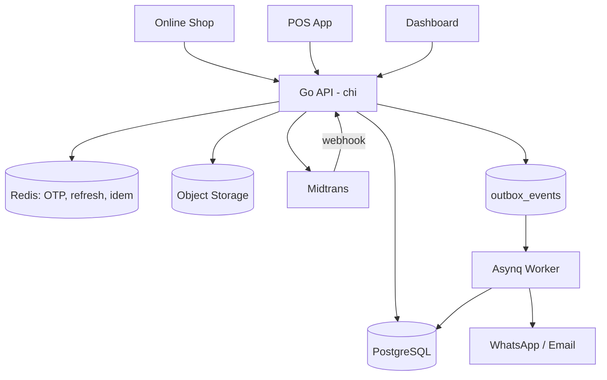
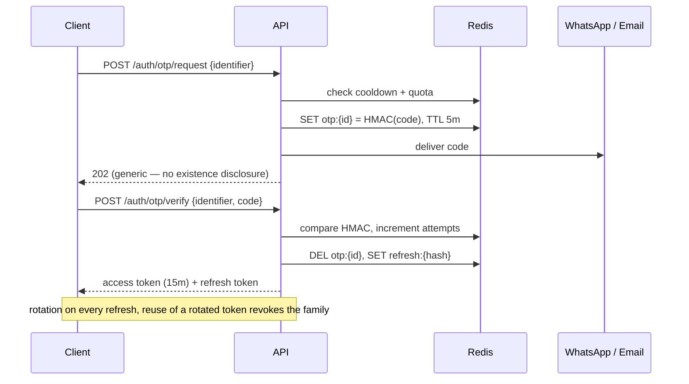
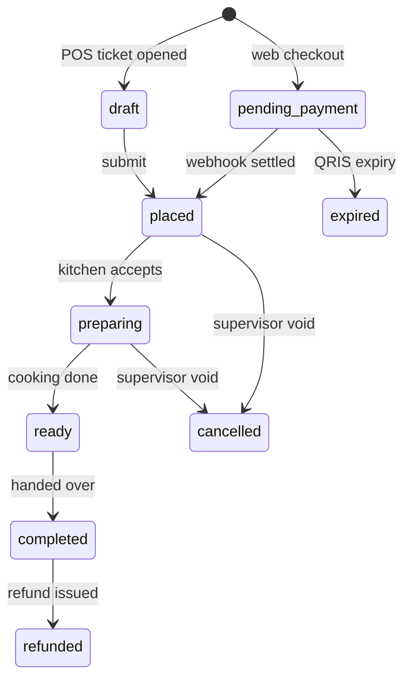
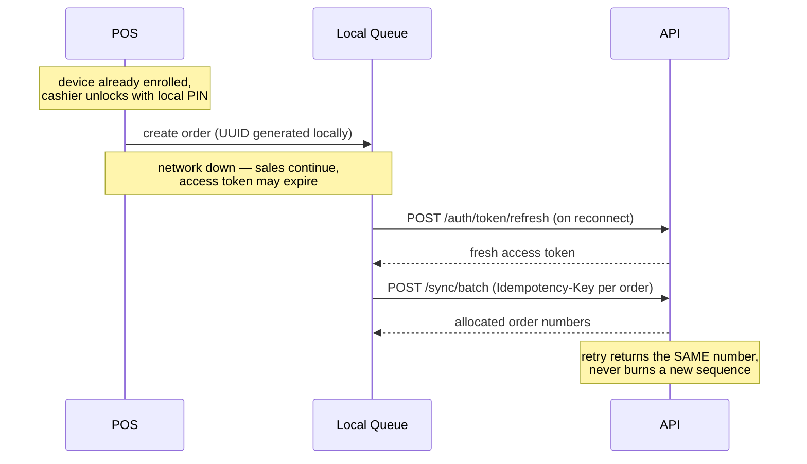

# MadKunyah Backend Service — Project Specifications

🍽️ **Unified backend for a multi-outlet Food & Beverage business** — one API serving the online shop, the in-store POS, and the owner dashboard.

**Cashless. Passwordless. Offline-tolerant.**

---

## 📌 Problem (Core Idea)

The business currently runs on disconnected tools:

- Online orders arrive in one place, counter orders in another
- Sales figures have to be manually stitched together across outlets
- Product and price changes must be re-entered per channel
- Static QRIS and card takings are reconciled by hand at close
- No single record of who voided, discounted, or refunded what

➡️ **One backend owns the catalog, the orders, the money, and the numbers. Every client is a thin view over the same truth.**

---

## 🧑‍💻 Users

|Persona|Client|Needs|
|---|---|---|
|Customer (guest)|Online shop|Order without signing up, pay by QRIS, track order status|
|Customer (account)|Online shop|OTP login, saved profile, order history, faster repeat ordering|
|Cashier|POS|Fast ticket entry, works offline, per-item dine-in/takeaway|
|Shift supervisor|POS|Voids after payment, price overrides, open/close shift, settlement check|
|Kitchen staff|POS / KDS|See what to cook, what to plate, what to box|
|Outlet manager|Dashboard|Outlet sales, staff, stock levels, variance reports|
|Business owner|Dashboard|Cross-outlet performance, margins, void/discount oversight|

---

## 🎯 Scope Decisions

Settled before schema design, because each one touches most tables:

|Decision|Choice|
|---|---|
|Outlets|**Multi-outlet from day one.** Every operational table carries `outlet_id`.|
|Terminals|**One POS device per outlet.** Order prefix is a flat `POS`; the prefix/sequence structure still allows `POS1`/`POS2` later without migration.|
|Authentication|**Passwordless — OTP over WhatsApp or email.** No password hashes stored for staff or customers.|
|Sessions|**JWT access + refresh.** Refresh tokens live in Redis; OTP codes live in Redis with TTL.|
|Cash|**No cash accepted.** Cashiers hold no physical money. Tenders are online QRIS, static QRIS, and card via EDC.|
|Inventory|**Item-level tracking now, recipe-ready schema.** A join table between products and stock items lets ingredient-level COGS slot in later.|
|Accounts|**Guest checkout is the default path**; optional customer accounts layered on top.|
|Loyalty / promos|**Out of v1.** Schema leaves room; no rules engine built yet.|
|Kitchen display|**Out of v1** as a separate client. The order event stream is built so a KDS can be added without backend changes.|
|Delivery|**Out of v1.** Dine-in, takeaway, and pickup only.|
|Split payments|**Not supported.** One payment per order; the `payments` table stays 1-to-many so this never needs a migration on live financial data.|

---

## ✨ Core Features

### A) Authentication — Passwordless

No password is ever stored. Both populations authenticate by one-time code delivered over WhatsApp (primary) or email (fallback).

**Flow**

1. `POST /auth/otp/request` with an identifier (phone or email)
2. Server generates a 6-digit code, stores an **HMAC of the code** in Redis with a 5-minute TTL, dispatches it via the notifier
3. `POST /auth/otp/verify` with identifier + code
4. On success: OTP key deleted, access token + refresh token returned

**Why the code is hashed, not stored raw:** Redis is a live cache that gets dumped, replicated, and inspected during debugging. A raw OTP in that dump is a working credential for its whole TTL window. Hashing costs nothing here.

**Abuse controls — mandatory, because every OTP costs real money on the WhatsApp API:**

|Control|Rule|
|---|---|
|Resend cooldown|60 seconds per identifier|
|Daily quota|Per identifier and per IP|
|Attempt limit|5 wrong codes → OTP invalidated, new request required|
|Single use|Code deleted on successful verification|
|Enumeration defence|Identical response and timing whether or not the identifier exists|
|Staff scope|Staff identifiers must already exist — no OTP is sent to unknown numbers, but the response is still generic|

**⚠️ The POS conflict.** OTP-only login is incompatible with an offline-first POS: no internet means no WhatsApp, which means the cashier cannot open the till. The resolution:

- OTP authenticates the **device once**, at enrollment, producing a long-lived device-bound refresh token
- Day-to-day, the cashier unlocks the already-authenticated device session with a **local PIN**
- That PIN is a _local session unlock_, not a server credential — it never authenticates to the API and grants nothing on a different device

This is technically still a stored secret, so it is stored as a hash and treated as low-trust: it gates who can act on an already-trusted device, and every action is still attributed and audited. If a device is lost, revoking its refresh-token family kills it server-side regardless of the PIN.

### B) Sessions — JWT + Redis

|Token|Lifetime|Storage|
|---|---|---|
|Access|15 minutes|Stateless JWT, not stored|
|Refresh (customer)|30 days|Redis, hashed|
|Refresh (staff, dashboard)|12 hours|Redis, hashed|
|Refresh (POS device)|90 days, sliding|Redis, hashed, device-bound|

**Rotation with reuse detection.** Every refresh issues a new token and invalidates the old one. If a token that has already been rotated is presented again, that is a theft signal — the entire token _family_ is revoked and the user must re-authenticate. Tracking a `family_id` per login is what makes this possible.

**Separate audiences.** Staff and customer tokens carry different `aud` claims and are validated by different middleware. A customer token must never be accepted on a staff route, even by accident.

**Offline token expiry.** A POS working offline will hold an expired access token. This is fine: the local queue holds unsent orders, and refresh happens when connectivity returns, before the sync batch is replayed. Orders are never blocked on token state — only their _sync_ is.

**Redis is now a hard dependency for auth.** Enable AOF persistence; a Redis flush logs out every user on every device. Refresh tokens are the one thing in Redis whose loss is user-visible.

```
otp:{purpose}:{identifier}      → {code_hmac, attempts, sent_at}     TTL 5m
otp:cooldown:{identifier}       → 1                                  TTL 60s
otp:quota:{identifier}:{date}   → counter                            TTL 24h
otp:quota:ip:{ip}               → counter                            TTL 1h
refresh:{token_hash}            → {subject_id, subject_type,
                                   device_id, family_id, issued_at}  TTL per table
refresh:family:{family_id}      → SET of token hashes
revoked:{jti}                   → 1                                  TTL 15m
idem:{scope}:{key}              → persisted response                 TTL 24h
```

### C) Access Control

**Staff** — created by admins, never self-signup. Roles are scoped per outlet, so one person can be a cashier at Outlet A and a manager at Outlet B.

|Role|Representative permissions|
|---|---|
|Cashier|Create orders, record payment, void **before** payment|
|Supervisor|Void after payment, apply discounts, price override, open/close shift|
|Outlet Manager|Manage outlet staff, stock, product availability, view outlet reports|
|Owner / Admin|All outlets, cost prices, margins, audit logs, global catalog|

**Customers** — OTP signup on first verify; no separate registration step. Guest orders capture a phone number without creating an account, so past orders can be linked retroactively if that customer later authenticates with the same number.

### D) Catalog

- Categories, products, and **variants** (size, temperature)
- **Modifier groups** with required/optional flags and min/max selections (sugar level, ice level, paid add-ons)
- **Per-outlet, per-channel pricing** — online prices commonly differ from counter prices to absorb payment fees
- Scheduled availability (breakfast menu until 11:00)
- Real-time sold-out toggle from POS, respected immediately by the online shop
- Channel visibility flags — some items are POS-only

### E) Orders

One order model across all channels. `channel` and per-line `fulfillment_type` are attributes, never separate tables.

**Per-line fulfillment.** The most important structural rule in this system: dine-in vs takeaway lives on the **line**, not the order. The header carries a derived `dine_in | takeaway | mixed` value for filtering only.

Consequences, all designed in:

- Two of the same product with different fulfillment are **two lines**, not one with qty 2
- Service charge is computed on the dine-in subtotal, not the order total
- Packaging fees attach to takeaway lines
- Kitchen tickets group by fulfillment type — plating and boxing are different actions
- All revenue reporting aggregates **from lines**, never from an order-level type column

**Order numbering.** Human-readable label, never an identity.

- Internal PK is a client-generated UUID (required for offline POS)
- `order_number` is a display string: `WEB-001`, `POS-001`
- Sequence **resets at the start of each shift**
- Uniqueness is `(outlet_id, shift_id, prefix, sequence)` — the number alone is _not_ unique
- Allocated at placement, not at draft creation, so abandoned tickets leave no gaps
- Allocation is a single atomic `UPDATE ... RETURNING` keyed by order UUID, so retries return the same number

With one terminal per outlet the cross-register collision problem disappears — but the prefix column stays, so adding a second device later means new prefixes rather than a schema change.

**Web orders attach to the outlet's currently-open shift.** Orders placed outside operating hours queue to the next shift. This keeps every shift's settlement covering all revenue in that window rather than counter revenue only.

### F) Payments — Cashless

**Online — Midtrans dynamic QRIS**

- Order sits in `pending_payment` and **does not reach the kitchen** until the webhook confirms
- The client's success redirect is never trusted
- Webhooks are signature-verified, idempotent, and tolerate out-of-order arrival (`settlement` can land before `pending`)
- A scheduled job expires unpaid orders at QRIS expiry and releases held stock
- Gateway fee recorded per transaction, so gross sales and actual payout can be reconciled

**In-store — POS as a recording tool**

Two tenders, both settled outside the system: `qris_static` (printed QR) and `card_edc`. The cashier records what happened; nothing verifies it.

**Removing cash changes the control model, and not entirely for the better.** With a drawer, a physical count was ground truth — the money either was there or it wasn't. Now _every_ in-store tender is an unverified claim, and there is no count to check it against on the day. The controls that replace it:

|Tender|System expects|Staff enters at close|Reconciled against|
|---|---|---|---|
|Static QRIS|Recorded QRIS sales|Merchant app total|QRIS settlement statement|
|Card (EDC)|Recorded card sales|EDC batch settlement slip|Acquirer statement|
|Online QRIS|Settled webhook total|— (system-verified)|Midtrans payout report|

- Variance logged per tender, mandatory note above a configurable threshold
- **Capture the RRN / reference** on static QRIS and EDC wherever the cashier can read it — without it, month-end matching against the bank statement is guesswork
- **Void and discount reporting becomes the primary fraud control**, since the classic drawer-shortage signal no longer exists

What you gain in exchange: no float, no bank drops, no drawer counts, no cash-in-transit risk, and a materially simpler shift close.

**Refunds.** `refund_method` is modelled independently of `payment_method` — QRIS refunds are frequently not programmatic and end up as a manual bank transfer with a reference entered by staff. With cash gone, an on-the-spot refund is no longer possible at all, so the manual-transfer path is not an edge case; it is the main path. Build the approval and reference capture properly.

### G) Shifts & Settlement

- Open/close shift per outlet, no opening float
- Order sequence counters reset on shift open
- Per-tender expected vs actual at close, with variance and notes
- Shift report: sales, voids, discounts, refunds, per-employee attribution
- Shift close is a **settlement check**, not a cash-up

### H) Inventory (item-level, recipe-ready)

The hinge is a `product_stock_links` join table.

- **Today:** one product → one stock item, quantity 1. Selling a burger decrements one burger.
- **Later:** one product → many stock items with real quantities. Selling a burger decrements 200g beef, one bun, one box.

Nothing about the movement ledger, the deduction job, or the reporting changes when that switch happens — only the rows in the join table.

- Per-outlet stock levels
- Append-only `stock_movements` ledger (sale, restock, waste, transfer, adjustment)
- Low-stock thresholds and alerts
- Optional stock-blocking on sale, per item

### I) Reporting

Served from **pre-aggregated read models**, never from live transactional tables.

- Sales by arbitrary date range, outlet, channel, product, category, employee, payment method, hour of day
- Dine-in vs takeaway split, computed from lines
- **Void and discount reports** — now the primary fraud signal
- Per-tender variance history by employee and outlet
- COGS and gross margin (item-level now, precise once recipes land)
- Period-over-period comparison

### J) Cross-cutting Guarantees

Architectural requirements, built in from the first migration:

|Concern|Approach|
|---|---|
|**Offline-first POS**|Client-generated UUIDs, local sync queue, device-bound long-lived refresh token, PIN-unlocked local session|
|**Idempotency**|`Idempotency-Key` header required on order creation, payment, and refund; keys stored in Redis with the persisted response|
|**Immutable line snapshots**|Product name, unit price, and modifier prices copied onto the line at sale time — later price changes never rewrite past revenue|
|**Money as integers**|`BIGINT` in the smallest currency unit. No floats anywhere, including in transit|
|**Business day ≠ calendar day**|Configurable per-outlet cutoff; every order carries `business_date`; all timestamps stored UTC, rendered in outlet timezone|
|**Audit log**|Every void, discount, price override, refund, OTP verification, and device enrollment: who, when, why, and the value moved|
|**Event bus**|Transactional outbox + worker. `order.paid` fans out to notification, inventory deduction, and report rollup independently|

---

## 🗄️ Data Model (PostgreSQL DDL)

> Starting point — **will evolve**. Indexes and some lookup tables omitted for readability. Note there is no `password_hash` column anywhere in this schema.

### Organisation & Access

```sql
CREATE TABLE outlets (
  id                  UUID PRIMARY KEY,
  name                TEXT NOT NULL,
  timezone            TEXT NOT NULL DEFAULT 'Asia/Jakarta',
  business_day_cutoff TIME NOT NULL DEFAULT '04:00',
  order_prefix        TEXT NOT NULL DEFAULT 'POS',
  address             TEXT,
  phone               TEXT,
  is_active           BOOLEAN NOT NULL DEFAULT TRUE,
  created_at          TIMESTAMPTZ NOT NULL DEFAULT now(),
  updated_at          TIMESTAMPTZ NOT NULL DEFAULT now()
);

CREATE TABLE outlet_hours (
  id          UUID PRIMARY KEY,
  outlet_id   UUID NOT NULL REFERENCES outlets(id),
  day_of_week SMALLINT NOT NULL,          -- 0=Sunday
  opens_at    TIME NOT NULL,
  closes_at   TIME NOT NULL,
  UNIQUE (outlet_id, day_of_week)
);

-- One POS device per outlet today. Kept as its own table because
-- refresh tokens and offline sync are bound to a physical device.
CREATE TABLE devices (
  id              UUID PRIMARY KEY,
  outlet_id       UUID NOT NULL REFERENCES outlets(id),
  name            TEXT NOT NULL,
  device_fingerprint TEXT UNIQUE,
  enrolled_by     UUID REFERENCES staff(id),
  enrolled_at     TIMESTAMPTZ NOT NULL DEFAULT now(),
  last_seen_at    TIMESTAMPTZ,
  catalog_version INT NOT NULL DEFAULT 0,  -- rejects stale-version syncs
  is_active       BOOLEAN NOT NULL DEFAULT TRUE
);

CREATE TABLE staff (
  id         UUID PRIMARY KEY,
  email      TEXT UNIQUE,
  phone      TEXT UNIQUE,                 -- OTP delivery target
  full_name  TEXT NOT NULL,
  pin_hash   TEXT,                        -- LOCAL device unlock only, not a login credential
  is_active  BOOLEAN NOT NULL DEFAULT TRUE,
  created_at TIMESTAMPTZ NOT NULL DEFAULT now(),
  updated_at TIMESTAMPTZ NOT NULL DEFAULT now(),
  CHECK (email IS NOT NULL OR phone IS NOT NULL)
);

CREATE TABLE roles (
  id          UUID PRIMARY KEY,
  code        TEXT UNIQUE NOT NULL,       -- cashier | supervisor | manager | owner
  name        TEXT NOT NULL,
  permissions JSONB NOT NULL DEFAULT '[]'
);

-- One person can hold different roles at different outlets.
CREATE TABLE staff_outlet_roles (
  staff_id  UUID NOT NULL REFERENCES staff(id),
  outlet_id UUID NOT NULL REFERENCES outlets(id),
  role_id   UUID NOT NULL REFERENCES roles(id),
  PRIMARY KEY (staff_id, outlet_id, role_id)
);

CREATE TABLE customers (
  id          UUID PRIMARY KEY,
  phone       TEXT UNIQUE NOT NULL,
  email       TEXT UNIQUE,
  full_name   TEXT,
  verified_at TIMESTAMPTZ,                -- set on first successful OTP verify
  created_at  TIMESTAMPTZ NOT NULL DEFAULT now(),
  updated_at  TIMESTAMPTZ NOT NULL DEFAULT now()
);

-- Security audit trail. OTP codes and refresh tokens live in Redis;
-- this is the durable record of what happened.
CREATE TABLE auth_events (
  id           UUID PRIMARY KEY,
  subject_type TEXT NOT NULL,             -- staff | customer
  subject_id   UUID,                      -- null if identifier was unknown
  identifier   TEXT NOT NULL,
  event        TEXT NOT NULL,             -- otp.requested | otp.verified | otp.failed
                                          -- | token.refreshed | token.reuse_detected
                                          -- | device.enrolled | session.revoked
  device_id    UUID REFERENCES devices(id),
  ip_address   INET,
  user_agent   TEXT,
  created_at   TIMESTAMPTZ NOT NULL DEFAULT now()
);
```

### Catalog

```sql
CREATE TABLE categories (
  id         UUID PRIMARY KEY,
  name       TEXT NOT NULL,
  sort_order INT NOT NULL DEFAULT 0,
  is_active  BOOLEAN NOT NULL DEFAULT TRUE
);

CREATE TABLE products (
  id          UUID PRIMARY KEY,
  category_id UUID REFERENCES categories(id),
  sku         TEXT UNIQUE,
  name        TEXT NOT NULL,
  description TEXT,
  image_url   TEXT,
  base_price  BIGINT NOT NULL,            -- smallest currency unit
  cost_price  BIGINT,                     -- owner-visible only
  is_active   BOOLEAN NOT NULL DEFAULT TRUE,
  created_at  TIMESTAMPTZ NOT NULL DEFAULT now(),
  updated_at  TIMESTAMPTZ NOT NULL DEFAULT now()
);

CREATE TABLE product_variants (
  id          UUID PRIMARY KEY,
  product_id  UUID NOT NULL REFERENCES products(id),
  name        TEXT NOT NULL,              -- 'Large', 'Iced'
  price_delta BIGINT NOT NULL DEFAULT 0,
  sku         TEXT UNIQUE,
  sort_order  INT NOT NULL DEFAULT 0,
  is_active   BOOLEAN NOT NULL DEFAULT TRUE
);

CREATE TABLE modifier_groups (
  id          UUID PRIMARY KEY,
  name        TEXT NOT NULL,              -- 'Sugar level', 'Add-ons'
  is_required BOOLEAN NOT NULL DEFAULT FALSE,
  min_select  INT NOT NULL DEFAULT 0,
  max_select  INT NOT NULL DEFAULT 1
);

CREATE TABLE modifiers (
  id                UUID PRIMARY KEY,
  modifier_group_id UUID NOT NULL REFERENCES modifier_groups(id),
  name              TEXT NOT NULL,
  price_delta       BIGINT NOT NULL DEFAULT 0,
  sort_order        INT NOT NULL DEFAULT 0,
  is_active         BOOLEAN NOT NULL DEFAULT TRUE
);

CREATE TABLE product_modifier_groups (
  product_id        UUID NOT NULL REFERENCES products(id),
  modifier_group_id UUID NOT NULL REFERENCES modifier_groups(id),
  sort_order        INT NOT NULL DEFAULT 0,
  PRIMARY KEY (product_id, modifier_group_id)
);

-- Per-outlet, per-channel override. Absence = inherit product defaults.
CREATE TABLE product_channel_settings (
  id             UUID PRIMARY KEY,
  product_id     UUID NOT NULL REFERENCES products(id),
  outlet_id      UUID NOT NULL REFERENCES outlets(id),
  channel        TEXT NOT NULL,           -- web | pos | all
  price          BIGINT,                  -- null = use base_price
  is_available   BOOLEAN NOT NULL DEFAULT TRUE,
  is_sold_out    BOOLEAN NOT NULL DEFAULT FALSE,
  available_from TIME,
  available_to   TIME,
  UNIQUE (product_id, outlet_id, channel)
);
```

### Inventory

```sql
-- Deliberately separate from products. Today a stock item IS a finished
-- product; tomorrow it can be an ingredient. Nothing downstream changes.
CREATE TABLE stock_items (
  id            UUID PRIMARY KEY,
  name          TEXT NOT NULL,
  unit          TEXT NOT NULL,            -- pcs | g | ml
  cost_per_unit BIGINT,
  is_active     BOOLEAN NOT NULL DEFAULT TRUE
);

-- The recipe-ready hinge. v1: one row per product, quantity 1.
CREATE TABLE product_stock_links (
  id                 UUID PRIMARY KEY,
  product_id         UUID NOT NULL REFERENCES products(id),
  product_variant_id UUID REFERENCES product_variants(id),
  modifier_id        UUID REFERENCES modifiers(id),
  stock_item_id      UUID NOT NULL REFERENCES stock_items(id),
  quantity           NUMERIC(12,3) NOT NULL DEFAULT 1
);

CREATE TABLE outlet_stock (
  outlet_id      UUID NOT NULL REFERENCES outlets(id),
  stock_item_id  UUID NOT NULL REFERENCES stock_items(id),
  quantity       NUMERIC(12,3) NOT NULL DEFAULT 0,
  low_threshold  NUMERIC(12,3),
  block_on_empty BOOLEAN NOT NULL DEFAULT FALSE,
  updated_at     TIMESTAMPTZ NOT NULL DEFAULT now(),
  PRIMARY KEY (outlet_id, stock_item_id)
);

-- Append-only ledger. Never updated, never deleted.
CREATE TABLE stock_movements (
  id            UUID PRIMARY KEY,
  outlet_id     UUID NOT NULL REFERENCES outlets(id),
  stock_item_id UUID NOT NULL REFERENCES stock_items(id),
  quantity      NUMERIC(12,3) NOT NULL,   -- signed
  reason        TEXT NOT NULL,            -- sale | restock | waste | transfer | adjustment | refund
  order_id      UUID,
  staff_id      UUID REFERENCES staff(id),
  note          TEXT,
  created_at    TIMESTAMPTZ NOT NULL DEFAULT now()
);
```

### Shifts & Order Numbering

```sql
-- No opening float, no drawer: this business takes no cash.
CREATE TABLE shifts (
  id            UUID PRIMARY KEY,
  outlet_id     UUID NOT NULL REFERENCES outlets(id),
  device_id     UUID REFERENCES devices(id),
  business_date DATE NOT NULL,
  opened_by     UUID NOT NULL REFERENCES staff(id),
  opened_at     TIMESTAMPTZ NOT NULL,
  closed_by     UUID REFERENCES staff(id),
  closed_at     TIMESTAMPTZ,
  status        TEXT NOT NULL DEFAULT 'open'   -- open | closed
);

-- Only one shift may be open per outlet at a time.
CREATE UNIQUE INDEX one_open_shift_per_outlet
  ON shifts (outlet_id) WHERE status = 'open';

-- Atomic sequence allocation: UPDATE ... RETURNING last_value + 1.
CREATE TABLE order_sequences (
  shift_id   UUID NOT NULL REFERENCES shifts(id),
  prefix     TEXT NOT NULL,               -- 'WEB' | 'POS'
  last_value INT NOT NULL DEFAULT 0,
  PRIMARY KEY (shift_id, prefix)
);

-- Settlement check at close. Every in-store tender is an unverified
-- claim, so this is the only control that exists on them.
CREATE TABLE shift_tender_reconciliations (
  id              UUID PRIMARY KEY,
  shift_id        UUID NOT NULL REFERENCES shifts(id),
  tender          TEXT NOT NULL,          -- qris_online | qris_static | card_edc
  expected_amount BIGINT NOT NULL,
  actual_amount   BIGINT NOT NULL,
  variance        BIGINT GENERATED ALWAYS AS (actual_amount - expected_amount) STORED,
  note            TEXT,
  recorded_by     UUID NOT NULL REFERENCES staff(id),
  recorded_at     TIMESTAMPTZ NOT NULL DEFAULT now(),
  UNIQUE (shift_id, tender)
);
```

### Orders

```sql
CREATE TABLE orders (
  id                  UUID PRIMARY KEY,   -- client-generated, offline-safe
  outlet_id           UUID NOT NULL REFERENCES outlets(id),
  shift_id            UUID REFERENCES shifts(id),
  device_id           UUID REFERENCES devices(id),

  -- Display label only. NEVER a foreign key, NEVER a lookup key.
  order_prefix        TEXT NOT NULL,
  order_sequence      INT  NOT NULL,
  order_number        TEXT NOT NULL,      -- 'POS-001'

  channel             TEXT NOT NULL,      -- web | pos
  fulfillment_summary TEXT NOT NULL,      -- derived: dine_in | takeaway | mixed
  status              TEXT NOT NULL,      -- see state machine below

  customer_id         UUID REFERENCES customers(id),   -- null for guests
  guest_name          TEXT,
  guest_phone         TEXT,
  tracking_token      TEXT UNIQUE,        -- opaque; the public tracking key

  table_number        TEXT,
  pickup_at           TIMESTAMPTZ,        -- null = ASAP
  note                TEXT,

  subtotal            BIGINT NOT NULL DEFAULT 0,
  discount_total      BIGINT NOT NULL DEFAULT 0,
  service_charge      BIGINT NOT NULL DEFAULT 0,  -- computed on dine-in lines
  packaging_fee       BIGINT NOT NULL DEFAULT 0,  -- computed on takeaway lines
  tax_total           BIGINT NOT NULL DEFAULT 0,
  grand_total         BIGINT NOT NULL DEFAULT 0,
  tax_breakdown       JSONB NOT NULL DEFAULT '{}', -- proof of how the total was reached

  business_date       DATE NOT NULL,
  placed_at           TIMESTAMPTZ,
  created_by          UUID REFERENCES staff(id),
  created_at          TIMESTAMPTZ NOT NULL DEFAULT now(),
  updated_at          TIMESTAMPTZ NOT NULL DEFAULT now(),

  -- The number is unique only within its shift.
  UNIQUE (outlet_id, shift_id, order_prefix, order_sequence)
);

CREATE TABLE order_lines (
  id                 UUID PRIMARY KEY,
  order_id           UUID NOT NULL REFERENCES orders(id) ON DELETE CASCADE,

  product_id         UUID NOT NULL REFERENCES products(id),
  product_variant_id UUID REFERENCES product_variants(id),

  -- Immutable snapshot. Reporting reads THESE, never the products table.
  product_name       TEXT   NOT NULL,
  variant_name       TEXT,
  unit_price         BIGINT NOT NULL,
  unit_cost          BIGINT,

  quantity           INT    NOT NULL CHECK (quantity > 0),

  -- Per-line, not per-order. The core rule of this system.
  fulfillment_type   TEXT   NOT NULL,     -- dine_in | takeaway

  discount_amount    BIGINT NOT NULL DEFAULT 0,
  discount_reason    TEXT,
  line_total         BIGINT NOT NULL,
  note               TEXT,
  status             TEXT NOT NULL DEFAULT 'active',  -- active | voided
  voided_by          UUID REFERENCES staff(id),
  void_reason        TEXT,
  created_at         TIMESTAMPTZ NOT NULL DEFAULT now()
);

CREATE TABLE order_line_modifiers (
  id            UUID PRIMARY KEY,
  order_line_id UUID NOT NULL REFERENCES order_lines(id) ON DELETE CASCADE,
  modifier_id   UUID NOT NULL REFERENCES modifiers(id),
  modifier_name TEXT   NOT NULL,          -- snapshot
  price_delta   BIGINT NOT NULL           -- snapshot
);

CREATE TABLE order_status_events (
  id          UUID PRIMARY KEY,
  order_id    UUID NOT NULL REFERENCES orders(id),
  from_status TEXT,
  to_status   TEXT NOT NULL,
  reason      TEXT,
  staff_id    UUID REFERENCES staff(id),
  created_at  TIMESTAMPTZ NOT NULL DEFAULT now()
);
```

### Payments & Refunds

```sql
CREATE TABLE payments (
  id            UUID PRIMARY KEY,
  order_id      UUID NOT NULL REFERENCES orders(id),
  method        TEXT NOT NULL,            -- qris_online | qris_static | card_edc
  amount        BIGINT NOT NULL,
  status        TEXT NOT NULL,            -- pending | settled | expired | failed

  provider      TEXT,                     -- 'midtrans' for online
  provider_ref  TEXT,                     -- transaction_id
  provider_fee  BIGINT,                   -- gross sales ≠ payout
  qr_string     TEXT,
  qr_expires_at TIMESTAMPTZ,
  external_ref  TEXT,                     -- RRN from EDC slip or static QRIS app

  recorded_by   UUID REFERENCES staff(id),
  settled_at    TIMESTAMPTZ,
  created_at    TIMESTAMPTZ NOT NULL DEFAULT now()
);

-- With cash gone, on-the-spot refunds are impossible. Manual bank
-- transfer is the main path, not the edge case.
CREATE TABLE refunds (
  id            UUID PRIMARY KEY,
  order_id      UUID NOT NULL REFERENCES orders(id),
  payment_id    UUID REFERENCES payments(id),
  amount        BIGINT NOT NULL,
  refund_method TEXT NOT NULL,            -- bank_transfer | provider
  bank_name     TEXT,
  account_name  TEXT,
  account_no    TEXT,
  reference     TEXT,                     -- transfer reference, entered by staff
  status        TEXT NOT NULL,            -- requested | approved | paid | rejected
  reason        TEXT NOT NULL,
  requested_by  UUID NOT NULL REFERENCES staff(id),
  approved_by   UUID REFERENCES staff(id),
  paid_at       TIMESTAMPTZ,
  created_at    TIMESTAMPTZ NOT NULL DEFAULT now()
);

CREATE TABLE payment_webhook_events (
  id           UUID PRIMARY KEY,
  provider     TEXT NOT NULL,
  event_id     TEXT NOT NULL,
  payload      JSONB NOT NULL,
  signature_ok BOOLEAN NOT NULL,
  processed_at TIMESTAMPTZ,
  received_at  TIMESTAMPTZ NOT NULL DEFAULT now(),
  UNIQUE (provider, event_id)             -- idempotency against retries
);
```

### Operational Infrastructure

```sql
CREATE TABLE audit_logs (
  id          UUID PRIMARY KEY,
  outlet_id   UUID REFERENCES outlets(id),
  actor_id    UUID,
  actor_type  TEXT NOT NULL,              -- staff | customer | system
  action      TEXT NOT NULL,              -- order.void | line.discount | price.override | refund.issue
  entity_type TEXT NOT NULL,
  entity_id   UUID NOT NULL,
  value_delta BIGINT,                     -- money moved, for fraud reporting
  reason      TEXT,
  before      JSONB,
  after       JSONB,
  created_at  TIMESTAMPTZ NOT NULL DEFAULT now()
);

CREATE TABLE outbox_events (
  id             UUID PRIMARY KEY,
  aggregate_type TEXT NOT NULL,
  aggregate_id   UUID NOT NULL,
  event_type     TEXT NOT NULL,           -- order.paid | order.ready | stock.low
  payload        JSONB NOT NULL,
  published_at   TIMESTAMPTZ,
  attempts       INT NOT NULL DEFAULT 0,
  created_at     TIMESTAMPTZ NOT NULL DEFAULT now()
);
```

> `idempotency_keys` and refresh/OTP state live in Redis, not Postgres — see the key schema in section B.

### Reporting Read Models

Populated by outbox workers. The dashboard never touches transactional tables.

```sql
CREATE TABLE daily_sales_summary (
  outlet_id      UUID NOT NULL REFERENCES outlets(id),
  business_date  DATE NOT NULL,
  channel        TEXT NOT NULL,
  order_count    INT    NOT NULL DEFAULT 0,
  gross_sales    BIGINT NOT NULL DEFAULT 0,
  discount_total BIGINT NOT NULL DEFAULT 0,
  net_sales      BIGINT NOT NULL DEFAULT 0,
  tax_total      BIGINT NOT NULL DEFAULT 0,
  cogs_total     BIGINT NOT NULL DEFAULT 0,
  void_count     INT    NOT NULL DEFAULT 0,
  void_amount    BIGINT NOT NULL DEFAULT 0,
  refund_amount  BIGINT NOT NULL DEFAULT 0,
  dine_in_sales  BIGINT NOT NULL DEFAULT 0,
  takeaway_sales BIGINT NOT NULL DEFAULT 0,
  PRIMARY KEY (outlet_id, business_date, channel)
);

CREATE TABLE product_sales_daily (
  outlet_id     UUID NOT NULL REFERENCES outlets(id),
  business_date DATE NOT NULL,
  product_id    UUID NOT NULL REFERENCES products(id),
  quantity_sold INT    NOT NULL DEFAULT 0,
  gross_sales   BIGINT NOT NULL DEFAULT 0,
  cogs_total    BIGINT NOT NULL DEFAULT 0,
  PRIMARY KEY (outlet_id, business_date, product_id)
);

CREATE TABLE hourly_sales_summary (
  outlet_id     UUID NOT NULL REFERENCES outlets(id),
  business_date DATE NOT NULL,
  hour_of_day   SMALLINT NOT NULL,
  order_count   INT    NOT NULL DEFAULT 0,
  gross_sales   BIGINT NOT NULL DEFAULT 0,
  PRIMARY KEY (outlet_id, business_date, hour_of_day)
);
```

---

## 🧱 Tech Stack

|Category|Choice|
|---|---|
|Language|**Go 1.23+**|
|HTTP router|`chi` (stdlib-compatible, minimal magic)|
|Database|PostgreSQL 16|
|Query layer|`sqlc` — generated type-safe Go from raw SQL|
|Migrations|`golang-migrate`|
|Redis|OTP codes, refresh tokens, idempotency keys, catalog cache — **AOF persistence on**|
|Background jobs|Asynq (Redis-backed) — outbox publisher, order expiry, report rollups|
|Auth|Passwordless OTP → JWT access + rotating refresh, separate audiences for staff and customers|
|JWT|`golang-jwt/jwt/v5`, asymmetric signing (ES256) so verification keys can be distributed|
|OTP delivery|WhatsApp Business API (primary), SMTP (fallback), behind a `Notifier` interface|
|Payments|Midtrans (dynamic QRIS) behind a `PaymentGateway` interface|
|File storage|S3-compatible (product images, receipt PDFs)|
|Validation|`go-playground/validator`|
|Rate limiting|Redis token bucket, applied hardest on OTP endpoints|
|Config|`viper` or a plain typed env struct|
|Logging|`log/slog`, structured JSON, request-scoped|
|Docs|OpenAPI 3 spec|
|Testing|`testify` + `testcontainers-go` (real Postgres + Redis)|
|Monitoring|Sentry + Prometheus metrics (later)|
|Deployment|Docker + Docker Compose; VPS or managed container host|

### Project Layout

```
cmd/
  api/            # HTTP server entrypoint
  worker/         # Asynq worker entrypoint
internal/
  domain/         # entities, value objects, business rules — no framework imports
  auth/           # OTP, JWT issuing, refresh rotation, device enrollment
  order/          # service + repository + handlers, per bounded context
  catalog/
  payment/
  inventory/
  shift/
  report/
  platform/
    postgres/     # sqlc output, migrations
    redis/        # otp store, token store, idempotency store
    midtrans/
    notifier/     # whatsapp, smtp
    outbox/
  middleware/     # auth, idempotency, rate limit, request logging
migrations/
api/openapi.yaml
```

---

## 🔌 Architecture



---

## 🔐 Auth Flow



---

## 🔄 Order Lifecycle



Web orders never enter `placed` on a client callback — only on a verified webhook.

---

## 📶 Offline POS



---

## 🔌 API Surface (indicative)

**Auth (shared shape, separate audiences)**

```
POST   /v1/auth/otp/request              # rate limited hard
POST   /v1/auth/otp/verify               # → access + refresh
POST   /v1/auth/token/refresh            # rotates; reuse revokes family
POST   /v1/auth/logout                   # deletes refresh token
POST   /v1/auth/devices/enroll           # OTP-gated, binds device
POST   /v1/auth/devices/{id}/revoke
POST   /v1/staff/me/pin                  # set local unlock PIN
```

**Public / customer**

```
GET    /v1/outlets                       GET  /v1/outlets/{id}/menu
POST   /v1/orders                        # guest or authenticated
GET    /v1/track/{tracking_token}        # opaque token, never order_number
POST   /v1/orders/{id}/payment           # returns Midtrans QRIS payload
GET    /v1/me/orders                     # accounts only
POST   /v1/webhooks/midtrans
```

**POS (staff)**

```
POST   /v1/shifts/open                   POST /v1/shifts/{id}/close
GET    /v1/pos/catalog                   # versioned bundle for offline use
POST   /v1/orders                        # Idempotency-Key required
PATCH  /v1/orders/{id}/lines             POST /v1/orders/{id}/lines/{lid}/void
POST   /v1/orders/{id}/payments          POST /v1/orders/{id}/refunds
POST   /v1/sync/batch                    # replay queued offline operations
```

**Dashboard**

```
GET    /v1/reports/sales?from&to&outlet_id&channel&group_by
GET    /v1/reports/products              GET /v1/reports/employees
GET    /v1/reports/voids-discounts       GET /v1/reports/tender-variance
GET    /v1/reports/shifts/{id}
CRUD   /v1/products  /v1/categories  /v1/modifiers
CRUD   /v1/staff     /v1/outlets     /v1/devices
GET    /v1/inventory/stock               POST /v1/inventory/movements
GET    /v1/audit-logs                    GET /v1/auth-events
```

---

## 🧭 Roadmap

### MVP — one outlet transacting end to end

- Outlets, devices, staff, roles
- OTP auth + JWT sessions + device enrollment
- Catalog with variants and modifiers
- Shifts, order sequences, offline-safe order creation
- Orders with per-line fulfillment type
- POS payment recording + Midtrans online QRIS
- Shift settlement with per-tender reconciliation
- Daily and range sales reports

### Phase 2 — multi-outlet and control

- Per-outlet pricing and availability
- Item-level inventory with movement ledger
- Void/discount and tender-variance reporting
- Customer accounts and order history
- Refund approval workflow with transfer reference capture
- COGS and margin reporting
- WhatsApp order status notifications

### Phase 3 — depth

- Kitchen display feed (order event stream already in place)
- Ingredient-level recipes → precise COGS and waste tracking
- Vouchers, promo rules engine, loyalty
- Delivery and delivery zones
- Marketplace integrations (GoFood / GrabFood)
- Public API and webhooks for third parties

---

## ⚠️ Known Design Risks

| Risk                                               | Mitigation                                                                                                                                                      |
| -------------------------------------------------- | --------------------------------------------------------------------------------------------------------------------------------------------------------------- |
| **OTP cost and abuse**                             | Every request costs real money on the WhatsApp API. Cooldown, per-identifier and per-IP quotas, attempt limits — build these with the first endpoint, not later |
| **OTP unusable offline**                           | Device enrolled once via OTP; daily access is a local PIN unlocking a device-bound session. Login never requires connectivity                                   |
| **Redis loss logs everyone out**                   | AOF persistence; treat Redis as stateful infrastructure, not a disposable cache                                                                                 |
| **Refresh token theft**                            | Rotation with family-level reuse detection; `auth_events` gives a durable trail                                                                                 |
| **No cash means no ground truth**                  | Every in-store tender is now an unverified claim. Per-tender settlement reconciliation and void/discount reporting are the only controls — make both mandatory  |
| **Refunds cannot be given on the spot**            | Explicit refund workflow with request → approve → transfer → reference capture; customers must be told the timeline                                             |
| Order numbers repeat across shifts                 | Support lookup is by number **+ business date + outlet**; reports never group by order number                                                                   |
| Midtrans webhook arrives before order is persisted | Webhook handler tolerates unknown order IDs and retries with backoff                                                                                            |
| Offline POS drifts from server catalog             | Catalog bundle is versioned per device; stale-version syncs rejected                                                                                            |
| Report rollups drift from source data              | Nightly reconciliation job recomputes summaries from `order_lines` and alerts on mismatch                                                                       |

---

🍽️ **One backend. Three clients. One version of the truth.**
