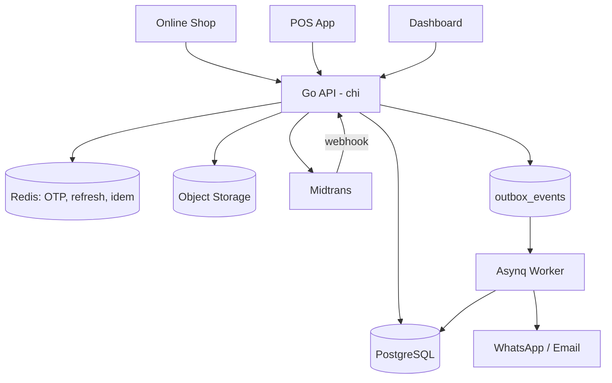
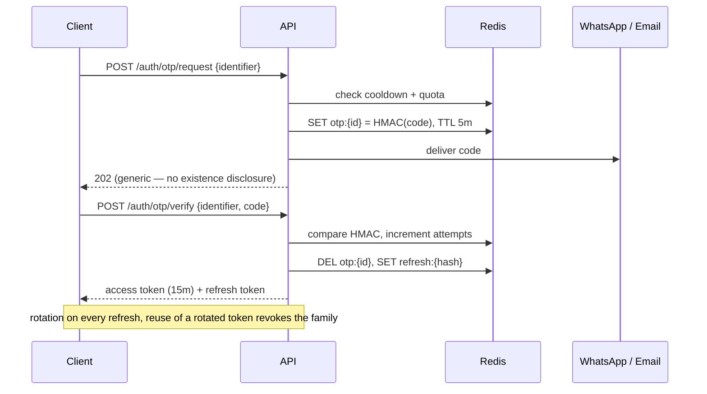
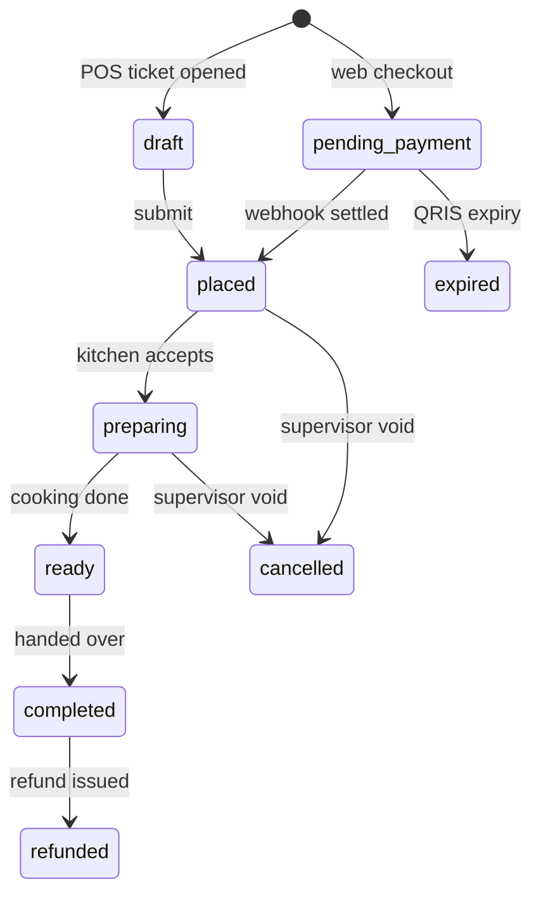
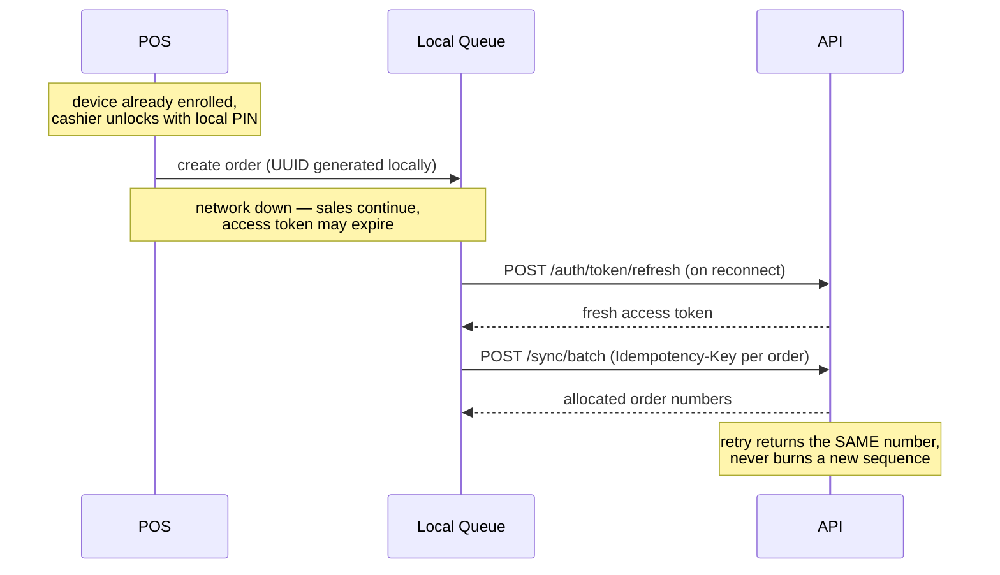

# MadKunyah — Flows and API Surface

Split out of `context/project-overview.md`.

## 🔌 Architecture



---

## 🔐 Auth Flow



---

## 🔄 Order Lifecycle



Web orders never enter `placed` on a client callback — only on a verified webhook.

---

## 📶 Offline POS



---

## 🔌 API Surface (indicative)

**Auth (shared shape, separate audiences)**

```
POST   /v1/auth/otp/request              # rate limited hard
POST   /v1/auth/otp/verify               # → access + refresh
POST   /v1/auth/token/refresh            # rotates; reuse revokes family
POST   /v1/auth/logout                   # deletes refresh token
POST   /v1/auth/devices/enroll           # OTP-gated, binds device
POST   /v1/auth/devices/{id}/revoke
POST   /v1/staff/me/pin                  # set local unlock PIN
```

**Public / customer**

```
GET    /v1/outlets                       GET  /v1/outlets/{id}/menu
POST   /v1/orders                        # guest or authenticated
GET    /v1/track/{tracking_token}        # opaque token, never order_number
POST   /v1/orders/{id}/payment           # returns Midtrans QRIS payload
GET    /v1/me/orders                     # accounts only
POST   /v1/webhooks/midtrans
```

**POS (staff)**

```
POST   /v1/shifts/open                   POST /v1/shifts/{id}/close
GET    /v1/pos/catalog                   # versioned bundle for offline use
POST   /v1/orders                        # Idempotency-Key required
PATCH  /v1/orders/{id}/lines             POST /v1/orders/{id}/lines/{lid}/void
POST   /v1/orders/{id}/payments          POST /v1/orders/{id}/refunds
POST   /v1/sync/batch                    # replay queued offline operations
```

**Dashboard**

```
GET    /v1/reports/sales?from&to&outlet_id&channel&group_by
GET    /v1/reports/products              GET /v1/reports/employees
GET    /v1/reports/voids-discounts       GET /v1/reports/tender-variance
GET    /v1/reports/shifts/{id}
CRUD   /v1/products  /v1/categories  /v1/modifiers
CRUD   /v1/staff     /v1/outlets     /v1/devices
GET    /v1/inventory/stock               POST /v1/inventory/movements
GET    /v1/audit-logs                    GET /v1/auth-events
```
