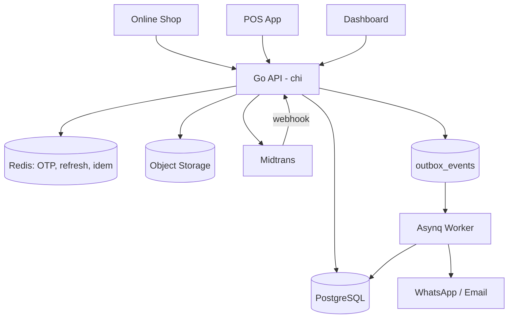
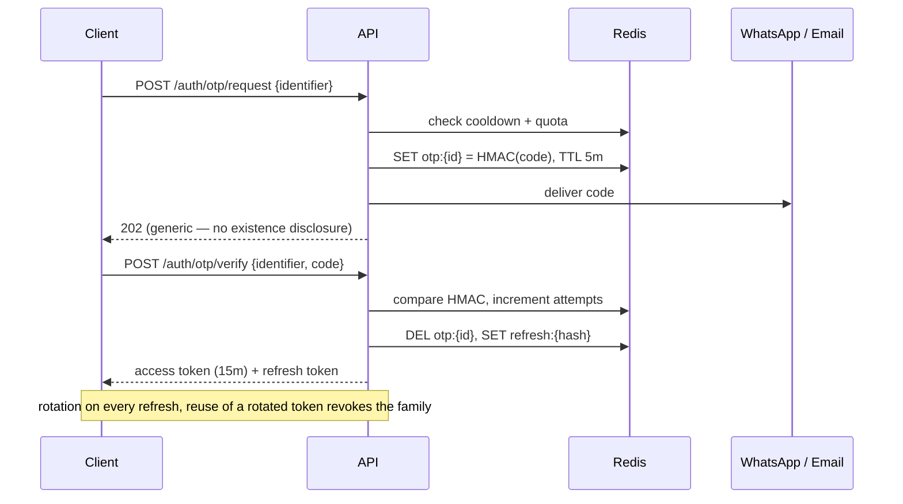
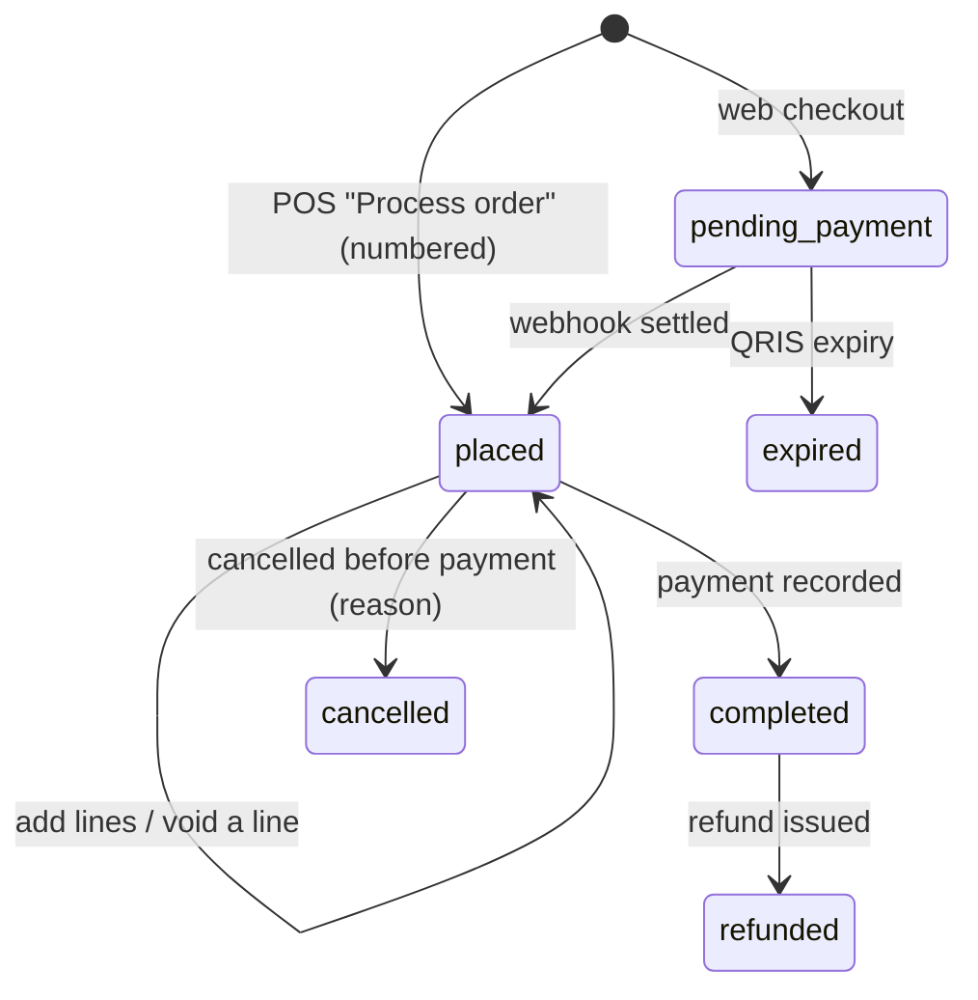
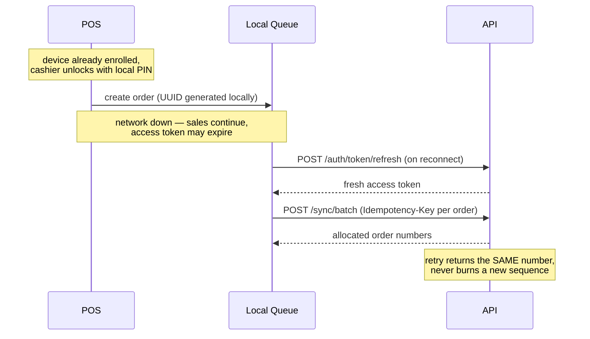

# MadKunyah — Flows and API Surface

Split out of `context/project-overview.md`.

## 🔌 Architecture



---

## 🔐 Auth Flow



---

## 🔄 Order Lifecycle



There are no server-side drafts: a POS ticket exists only on the device until *Process order*. A POS order is `placed` as an open bill and **payment completes it**; there is no separate handover step. `paid_at` marks payment and is not a status. A paid order is voided only by a holder of `order.void.paid` (Refunds + Paid Void). `preparing` and `ready` are allowed by the schema for kitchen statuses later.

Web orders never enter `placed` on a client callback — only on a verified webhook.

---

## 📶 Offline POS



---

## 🔌 API Surface (indicative)

**Auth (shared shape, separate audiences)**

```
POST   /v1/auth/otp/request              # rate limited hard
POST   /v1/auth/otp/verify               # → access + refresh
POST   /v1/auth/token/refresh            # rotates; reuse revokes family
POST   /v1/auth/logout                   # deletes refresh token
POST   /v1/auth/devices/enroll           # OTP-gated, binds device
POST   /v1/auth/devices/{id}/revoke
POST   /v1/staff/me/pin                  # set local unlock PIN
```

**Public / customer**

```
GET    /v1/outlets                       GET  /v1/outlets/{id}/menu
POST   /v1/orders                        # guest or authenticated
GET    /v1/track/{tracking_token}        # opaque token, never order_number
POST   /v1/orders/{id}/payment           # returns Midtrans QRIS payload
GET    /v1/me/orders                     # accounts only
POST   /v1/webhooks/midtrans
```

**POS (device token + `X-Acting-Staff-Id`; outlet from the token)**

```
GET    /v1/pos/shifts/current            POST /v1/pos/shifts
POST   /v1/pos/shifts/{id}/close
GET    /v1/pos/catalog                   # versioned bundle for offline use
POST   /v1/pos/orders                    # process order; retry-safe by client order id
GET    /v1/pos/orders                    # ?status=placed = open bills of the open shift
GET    /v1/pos/orders/{id}
POST   /v1/pos/orders/{id}/lines         # add lines; retry-safe by line ids
POST   /v1/pos/orders/{id}/lines/{lid}/void
POST   /v1/pos/orders/{id}/cancel
POST   /v1/pos/orders/{id}/payments      # retry-safe by client payment id
POST   /v1/pos/orders/{id}/refunds       # Refunds + Paid Void
POST   /v1/sync/batch                    # replay queued offline operations
```

**Dashboard**

```
GET    /v1/reports/sales?from&to&outlet_id&channel&group_by
GET    /v1/reports/products              GET /v1/reports/employees
GET    /v1/reports/voids-discounts       GET /v1/reports/tender-variance
GET    /v1/reports/shifts/{id}
GET    /v1/outlets/{id}/shifts           GET /v1/outlets/{id}/shifts/{sid}
GET    /v1/outlets/{id}/orders           GET /v1/outlets/{id}/orders/{oid}
CRUD   /v1/products  /v1/categories  /v1/modifiers
CRUD   /v1/staff     /v1/outlets     /v1/devices
GET    /v1/inventory/stock               POST /v1/inventory/movements
GET    /v1/audit-logs                    GET /v1/auth-events
```
